# Amoris benchmark results

[Amoris](https://github.com/qiulinfan/amoris) is an agent-native 3D game engine: a Rust host, game
rules in TypeScript, a wgpu renderer on Metal, Vulkan, Direct3D 12 and WebGPU in the browser, a web
editor, and one set of commands shared by people and AI agents. This page shows how it measures up
against open-source engines and libraries, what its own optimizations bought, and what it looks
like running. Some results come from Amoris Pioneer, the engine's experimental line, before they
reach the main repository. Every chart names its hardware, backend and date, and links to its
method or, until that work reaches the main repository, to its run data.

## Against open-source engines and libraries

### Bevy 0.19: 1.6 million cubes

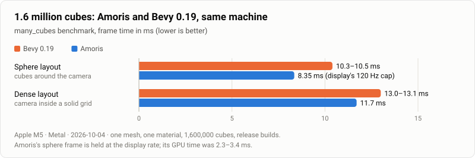

Apple M5, Metal, 2026-10-04. Bevy's own `many_cubes` example against Amoris drawing the same
layouts on the same machine. [Method](https://github.com/qiulinfan/amoris/blob/main/docs/bench/bevy-baseline.md)

### three.js r186: the same scene in Chrome

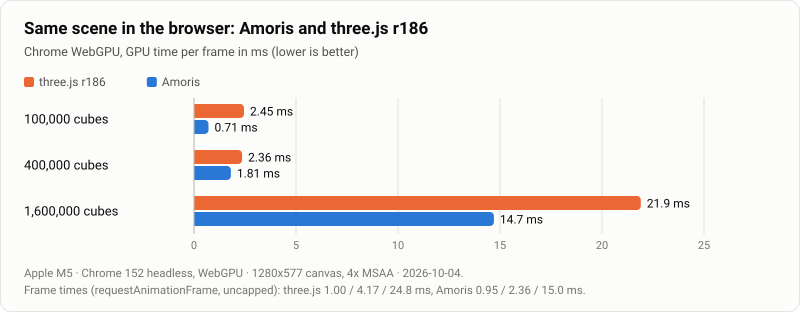

Apple M5, Chrome 152 (WebGPU), 2026-10-04. three.js draws one `InstancedMesh`, its fastest path for
copies of a mesh; it culls that mesh as a whole and draws every copy, while Amoris, its native
renderer compiled to WebAssembly, culls each cube on the GPU. These figures predate later changes
to the Amoris viewport. [Method](https://github.com/qiulinfan/amoris/blob/main/docs/bench/web.md)

### Jolt Physics 5.6

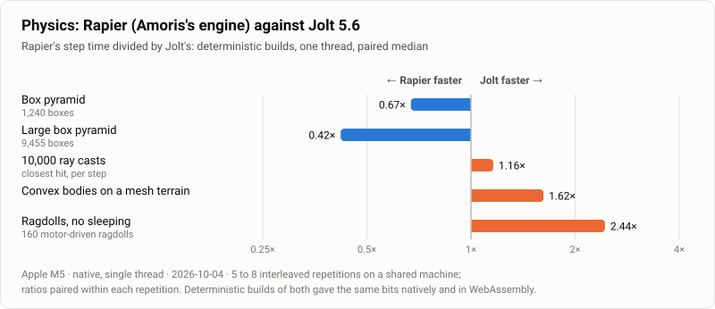

Apple M5, native, one thread, 2026-10-04. Amoris ships Rapier with cross-platform determinism, so a
game gives the same bits natively and in the browser. Rapier steps box stacks faster, Jolt is faster
on meshes and ragdolls, and ray casts are close. In WebAssembly (V8 under Node), Jolt's fastest
runs beat Rapier's shipped build on all four scenes measured there, least clearly on the box
pyramid. The machine was shared with other work, so the chart shows paired ratios, the reliable
figure.
[Method](https://github.com/qiulinfan/amoris/blob/main/docs/bench/physics.md)

## What the engine's own work bought

### Two-phase occlusion culling

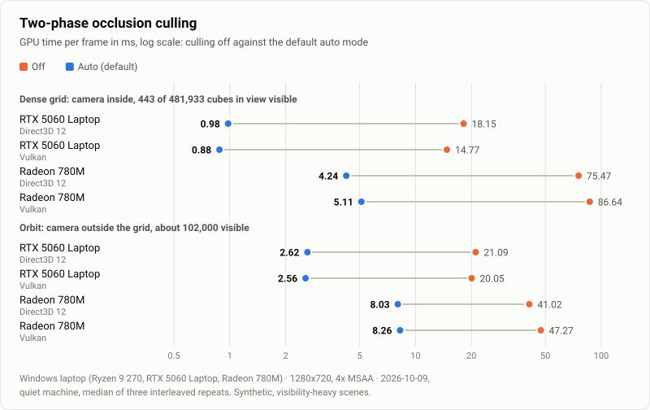

ASUS ROG Zephyrus G14 (Ryzen 9 270, RTX 5060 Laptop GPU, Radeon 780M), Windows 11, Direct3D 12 and
Vulkan, 2026-10-09. Where nothing is hidden, the auto mode costs what culling off does: 2.26 ms
against 2.26 ms for 1.6 million cubes around the camera (RTX 5060, Direct3D 12, 2026-10-10).
[Method](https://github.com/qiulinfan/amoris/blob/main/docs/bench/occlusion.md)

### Mesh levels of detail

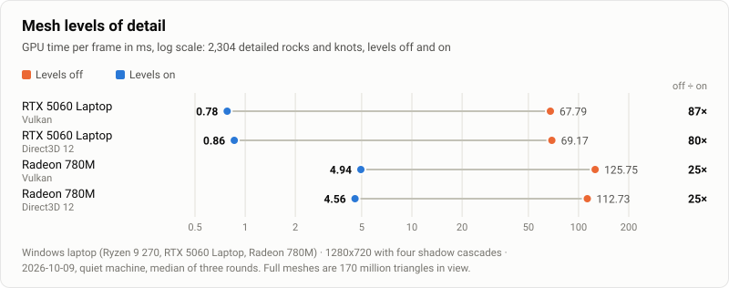

Same laptop, Vulkan and Direct3D 12, 2026-10-09. A synthetic field of 2,304 rocks and knots whose
full meshes are deliberately expensive, so the ratio shows what levels can save, not a whole-game
speedup. [Method](https://github.com/qiulinfan/amoris/blob/main/docs/bench/lod.md)

### Shadow cascades culled by their camera slice

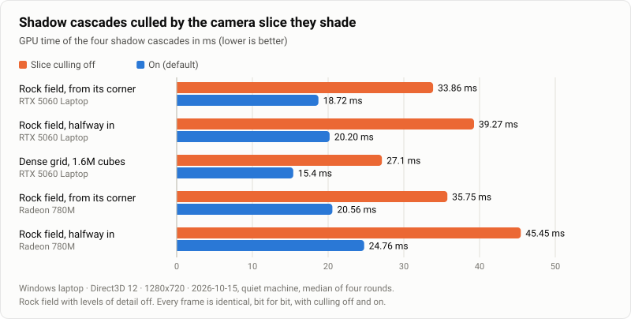

Same laptop, Direct3D 12, 2026-10-15 (Amoris Pioneer). Each cascade now skips casters that cannot
shadow anything in the slice of the view it covers, and its cost falls with the triangles it drops.
The method page follows when this work reaches the main repository; until then, the
[run data](sources/pioneer-shadowcull-20261015/quiet/).

### Many moving objects

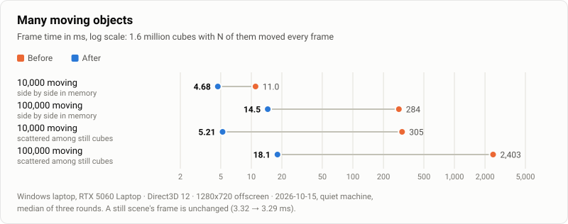

Same laptop, RTX 5060, Direct3D 12, 2026-10-15 (Amoris Pioneer). Applying moves is now linear, about
60 ns per moved object, and scattered moves reach the GPU in one write instead of one write each.
The method page follows when this work reaches the main repository; until then, the
[run data](sources/pioneer-dynscene-20261015/quiet/).

### Editor latency

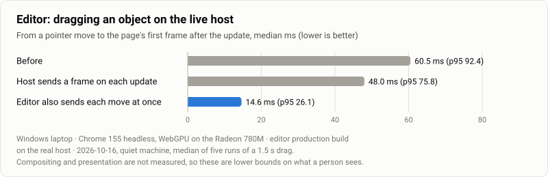

Same laptop, Chrome 155 (WebGPU on the Radeon 780M), the real host, 2026-10-16 (Amoris Pioneer). The
host now sends a frame as soon as the game publishes a change instead of checking every 16 ms, and
the editor sends a drag's change at once when none is in flight, instead of at most every 60 ms.
Presentation to the screen is not included, so these are lower bounds. The method page follows
when this work reaches the main repository; until then, the
[run data](sources/pioneer-serveloop-20261016/quiet/).

## Neural texture compression

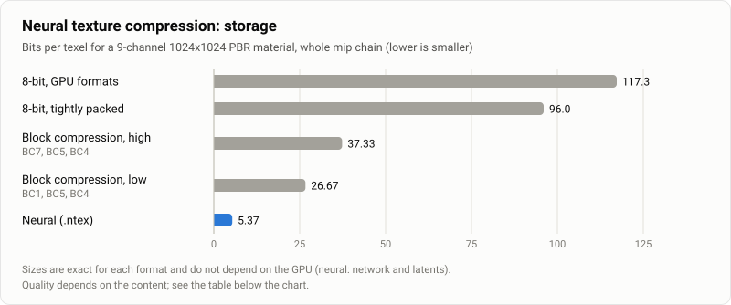

Quality is content-dependent. PSNR at mip 0 against the 8-bit source, in dB (higher is better):

| Material and channels | Neural | BC high | BC low | BC at half resolution |
| --- | ---: | ---: | ---: | ---: |
| Bricks, base color | 47.45 | 55.39 | 42.60 | 38.23 |
| Bricks, normal | 41.91 | 43.99 | 43.99 | 30.26 |
| Rendered street picture, base color | 35.28 | 47.55 | 37.08 | 31.23 |

Decoding costs GPU time: a full-screen 1080p view adds 1.52–1.60 ms on the RTX 5060 Laptop GPU and
3.14–4.41 ms on the Radeon 780M (f16, Direct3D 12 and Vulkan, 2026-10-10).
[Method](https://github.com/qiulinfan/amoris/blob/main/docs/bench/neural-textures.md)

## Agents fixing bugs

An LLM agent (GLM 5.3 Flash in opencode) gets a player's description of one of six planted
TypeScript bugs in the sailing game, finds it through the running engine and fixes it; a fresh host
then checks the fix against a 720-tick scenario.

| How the agent worked | Runs | Fixed | Named the planted line |
| --- | ---: | ---: | ---: |
| Command line, free choice of tools | 13 | 11 | 11 |
| Command line, debugger required | 7 | 7 | 6 |
| MCP, free choice of tools | 3 | 3 | 1 |

Apple M5, 2026-10-04. The runs predate the harness's current isolation (the old sandbox could
reveal bug names through directory names and kept a clean copy of the game within reach), and the
sample is small, two or three trials per bug, so the rates are indicative.
[Method](https://github.com/qiulinfan/amoris/blob/main/docs/bench/debug-eval.md)

## Scenes

Click a picture to open its video.

<table>
  <tr>
    <td width="50%" valign="top">
      <a href="media/scene.mp4">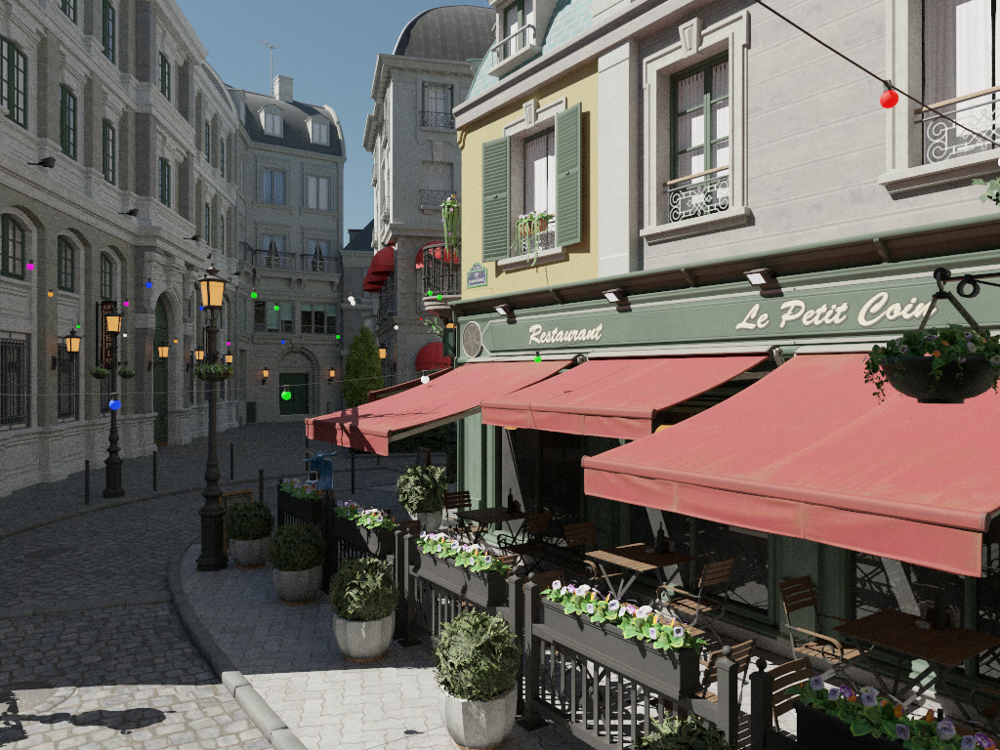</a>
       <b>Bistro exterior.</b> 2.83 million triangles, 132 materials and 405 textures in the
      native renderer at 1080p. Model: Amazon Lumberyard Bistro, ORCA (2017), CC BY 4.0.
    </td>
    <td width="50%" valign="top">
      <a href="media/detail.mp4">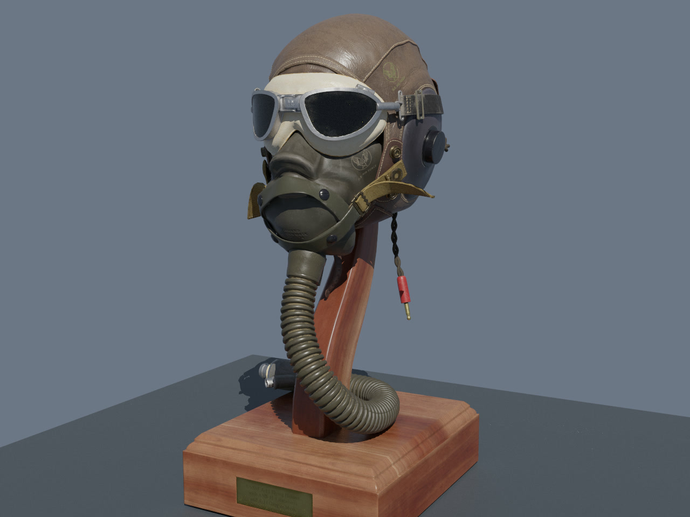</a>
       <b>Flight Helmet up close.</b> 94,722 triangles with their authored PBR maps, native Metal
      renderer. Model CC0.
    </td>
  </tr>
  <tr>
    <td width="50%" valign="top">
      <a href="media/deepseek-gameplay.mp4">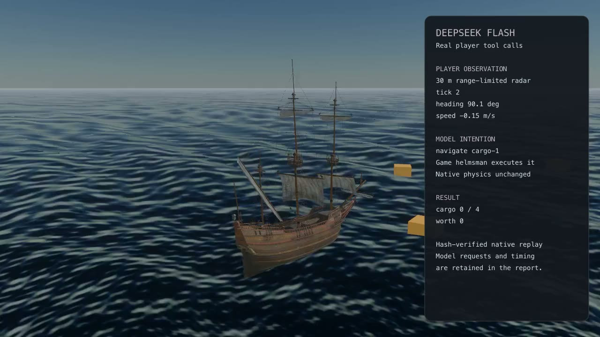</a>
       <b>DeepSeek at the helm.</b> Real DeepSeek Flash decisions through the range-limited
      player interface, replayed natively; every action and the final world state match the
      recorded run. It collected all four crates. Ship model CC0.
    </td>
    <td width="50%" valign="top">
      <a href="media/agent.mp4">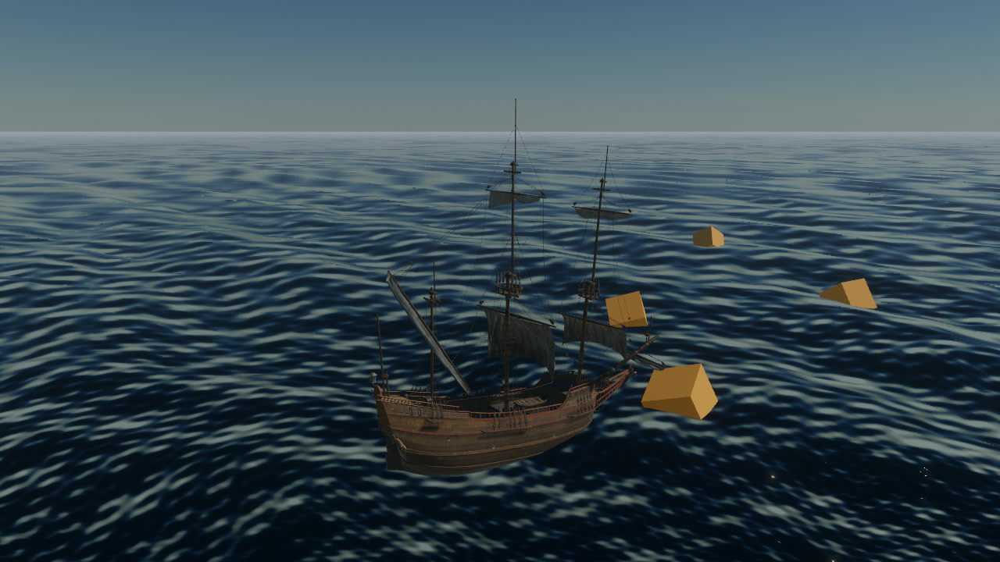</a>
       <b>A scripted agent sails through MCP.</b> It tries four steering choices on forks of the
      world, picks one and collects two crates. Developer access, not the player interface.
      Ship model CC0.
    </td>
  </tr>
</table>

The Bistro and helmet pictures are offline path-traced stills of the same scenes; the videos are
frames of the interactive renderer.

## Licenses

Engine-authored material is MIT licensed ([license](LICENSES/amoris-engine-MIT.txt)). The videos
and pictures show third-party models whose authors and licenses are listed in the
[credits](LICENSES/showcase-credits.md): Amazon Lumberyard Bistro (CC BY 4.0), Flight Helmet and
Dutch Ship Medium (CC0).
